# Veritas Claims — medical data standardisation pipeline

Raw clinic JSON in, a canonical analytics schema out, with every
standardisation decision recorded so a claims analyst can audit it.

```bash
python3 -m pip install pyyaml      # the only runtime dependency
make demo                          # process all 17 sample files
make serve                         # operations dashboard at :8080
```

No cloud account, no API key, no build step. The whole thing runs on Python
3.10+ and PyYAML.

---

## Start here: what I found in your sample data

I profiled the five supplied files before designing anything. They are not a
clean dataset with cosmetic inconsistencies. **One of the two lab reports
contains a defect that silently produces clinically wrong values**, and the
architecture is shaped around catching it.

This is `Sample_JSON_file2.json`, exactly as received:

| row | `test_name` | `range` | `unit` | `result` |
|----:|---|---|---|---|
| 0 | `aemoglobin` | `4000-10000` | `cell/cu.mm` | `9700` |
| 1 | `tal WBC Count` | `4.50-5.50` | `mil/cu.mm` | `5.45` |
| 2 | `BC INDICES` | `36-46` | `%` | `44.9` |
| 3 | `ematocrit HCT` | `83-101` | `FL` | `82` |

Row 0 is named haemoglobin. Haemoglobin is roughly 13-17 g/dL. This row carries
`9700` with a range of `4000-10000` in `cell/cu.mm` — **a white cell count**.
Row 1 names the WBC count but carries `4.50-5.50 mil/cu.mm`, a **red cell
count**. Row 3 names the haematocrit but carries `83-101 FL`, an **MCV**.

The names are the standard CBC panel in printed order. The values are the same
panel starting one position later. An OCR row-drop shifted the name column
against the value columns, and separately cropped a character off the left edge
of each name. **The same pattern appears in `Sample_JSON_file5.json`, from a
different source system**, so it is systemic rather than one bad file.

### Why this is the dangerous finding

A fuzzy matcher resolves `aemoglobin` → `HAEMOGLOBIN` at 0.97 confidence, and
it is **correct about the name**. A pipeline that resolves the name and loads
the value writes a white cell count into a haemoglobin column. Nothing
downstream can tell: the test exists, the value is a number, the row is
complete. Automated adjudication then acts on it.

String matching cannot catch this, because the string matching is right.

### What this pipeline does instead

Every canonical test declares a unit **dimension** and a plausible value
envelope. Two independent checks follow:

- `cell/cu.mm` measures a **count**; haemoglobin is a **mass concentration** →
  dimension mismatch, row quarantined.
- `4000-10000` against haemoglobin's physiological envelope of `1-25` is three
  orders of magnitude out → range implausible.

Then at report level, the pipeline says:

> 6 of 15 checkable rows are incoherent with the test they name; 3 of the 4
> rows where the hypothesis is testable (75%) cohere instead with the test
> named 1 row later. **The value columns appear shifted by +1.**
>
> *Proposal: shift value columns by +1 after human confirmation; not applied
> automatically.*

**It never realigns the rows itself.** A wrong realignment writes a
plausible-looking wrong value into a claim decision and is undetectable
downstream. The offset goes to a human in the review queue. Refusing to be
clever is the correct engineering choice when the cost of being wrong is a
mis-adjudicated medical claim.

### Nine more findings, all reproducible

`make profile` prints the evidence for each straight from the raw files, with
no pipeline code involved.

| # | finding | evidence |
|---|---|---|
| F-1 | **Name/value misalignment** | above; recurs in a second source system |
| F-2 | **The source's own verdict is wrong 41% of the time** | 24 of 59 checkable rows. `82` in range `83-101` labelled "normal"; `124` in `38-126` labelled "high" |
| F-3 | **One column, two meanings** | `test_analytics` holds interpretations *and* assay methods **inside one file** |
| F-4 | **Duplicates don't share identifiers** | files 1 and 3 are the same discharge summary with different `documentId`, `traceId` and `claim_no`. `DISTINCT document_id` adjudicates that claim twice |
| F-5 | **Panels repeat across pages** | 73 of 193 rows in file 4 are verbatim repeats |
| F-6 | **Eleven result grammars** | `4,290 cells/cu.mm`, `H 0.7 %`, `100/60 mmHg`, `99% On Room Air`, `OTE`, a whole panel in one cell |
| F-7 | **Values hidden inside names** | `"LFT ( SGOT - 38, SGPT -14, ALP - 127)"` — three measurements no rule would ever read |
| F-8 | **Placeholders and leaked structure** | the PDF header row as data; `reports_date: "DD/MM/YYYY"`; a bill *number* in `bill_date` |
| F-9 | **49 unit spellings** | including OCR corruption: `gm/di`, `FI`, `UIL`, and the Indian `lakhs/cumm` (10⁵) |
| F-10 | **Ambiguity only the unit settles** | `NEUTROPHILS` in `%` and in `cells/cu.mm` are different tests with different ranges |

Full write-up: **[`docs/data-profile.md`](docs/data-profile.md)**.

---

## What `make demo` prints

```
  files      discovered=17  processed=14  skipped=0  failed=3
  documents  emitted=16  duplicate=3
  rows       emitted=286  flagged=211  invalid=84  outlier=7  out_of_range=74
  medicines  emitted=45
  review     dead_letters=34  queue=100  misaligned_reports=2
  genai      calls=3  cache_hits=0

  dead-lettered    16  panel_heading
  dead-lettered     4  section_heading
  dead-lettered     1  malformed_json          ← and the run continued
  ...
  REPORT QUARANTINED FOR SUSPECTED COLUMN MISALIGNMENT
    row 0: named 'HAEMOGLOBIN'; evidence fits 'WHITE BLOOD CELL COUNT'
  ...
  SOURCE VERDICT WRONG on 21 of 99 checkable rows (21%) — recomputed
```

Three files fail on purpose (truncated JSON, a top-level array, an empty
document list) and the run continues — one clinic's bad upload must never stop
the other 499.

Then `make serve` for the dashboard, flagged-row queue, per-source quality,
duplicate audit, dead letters, and a record inspector showing the clinic's raw
JSON beside the standardised output.

---

## How it works



| layer | what happens | requirement |
|---|---|---|
| **Ingest** | GCS → Pub/Sub → Cloud Run. SHA-256 at the boundary becomes the idempotency key *and* the lineage anchor | FR-1 |
| **Route** | Schema-on-read: field *locations* are config paths, field *names* are candidate lists. An unknown clinic flows under `_default` on day zero | FR-1.3, NFR-2.1 |
| **Dedup** | Content hash of the clinical payload, not the source's identifiers | FR-1.2 |
| **Standardise** | 5-tier name resolution · result parsing · dimensional unit conversion · range parsing · demographics · brand→molecule | FR-2 |
| **Validate** | Coherence engine, then classification separating *readable* / *possible* / *normal* | FR-3 |
| **Load** | Narrow fact table; MERGE on a deterministic key. BigQuery via free load jobs | FR-4 |
| **Serve** | The required 78-column shape and the 5-per-test shape, both as **views** | FR-4.1, FR-2.2 |
| **UI** | Dashboard, flagged queue, clinic quality, record inspector | FR-5 |

### Name resolution: five tiers, cheapest first

```
exact → alias → normalised → fuzzy → LLM (tail only) → human review
  1.00    1.00      0.97      score     ≤0.80            promoted to config
```

Every row records **how** it was resolved and with what confidence, so an
analyst can see that a number came from a 0.88 fuzzy match with two near-ties
and exclude it.

The fuzzy tier is hand-written, not a library, because the dominant defect is
an OCR **crop** — `aemoglobin`, `atelet Count`, `eutrophils` — and edit
distance alone has no notion that losing an affix is far likelier than changing
a middle character. Affix matches are reported as their own method, so a clinic
whose scanner is degrading becomes *measurable*.

When two tests legitimately share a name, the **unit** decides:
`NEUTROPHILS` + `%` → `NEUTROPHILS PERCENT`; `NEUTROPHILS` + `cells/cu.mm` →
`ABSOLUTE NEUTROPHIL COUNT`. Without that, one of the two is always classified
against the wrong band.

### Three questions, deliberately not collapsed

| question | answer | why it matters |
|---|---|---|
| Is it **readable**? | `Invalid` | a column-collapse artefact, not a value |
| Is it **possible**? | `Outlier` | haemoglobin 0.1 is bad data, not a dying patient |
| Is it **normal**? | `Within` / `Above` / `Below Range` | the clinical finding |

Conflating the last two is the expensive mistake: it sends broken feeds to the
clinical queue and buries genuine critical values among them.

### Where GenAI belongs

| | LLM on every row | LLM on the unmapped tail |
|---|---:|---:|
| cost/day | **~$3,300** | **~$0.17** |
| cost/year | **~$1,200,000** | **~$64** |

30M rows/day against ~2,000 novel names/day. The dictionary already answers 97%
of rows exactly, reproducibly and for free; replacing that with a probabilistic
call adds no accuracy and removes reproducibility.

So GenAI handles only what deterministic code cannot: naming a test from a
spelling never seen before, and recovering values buried inside names. Every
accepted answer is **promoted into the alias dictionary**, so a novel spelling
is paid for once and is free forever. That ratchet is the mechanism behind
NFR-4.1's "98% within 30 days" — not a hope, a decaying tail.

Without an API key the pipeline runs a deterministic local fallback labelled
`stub`, so output is identical on every run and nothing from the fallback can
be mistaken for a model decision. Workings: **[`docs/cost-model.md`](docs/cost-model.md)**.

---

## The numbers

### Throughput and capacity

`make bench` generates a synthetic corpus carrying the same defects as the real
one, runs the real pipeline over it, and turns the measurement into capacity
and cost. Current result in [`bench/results.json`](bench/results.json).

Measured: **16.5 files/second per worker**, 9,879 rows/second, **0.061
CPU-seconds per file** (150 rows, including fuzzy matching and every coherence
check).

200,000 files/day is **2.31 files/second**, bursting to 4.62. So **one Cloud
Run instance covers the steady state and the 2× burst with 7× headroom**, and a
full day's volume processes in 50 minutes. That is the entire basis for
choosing Cloud Run over Dataflow — which cannot scale below one always-on
worker plus a shuffle service, and would cost roughly 10× for a capability this
problem does not need.

Estimated all-in infrastructure: **~$50/month** at 200k files/day — of which
the largest line is GCS operations, not compute.

### Idempotency, proven rather than claimed

```
$ make verify
                              run 1        run 2
clinical_document               16           16
lab_result                     286          286
medication                      45           45
processing_error                34           34
review_item                     97           97
content checksum  70f5c81fd24ea9b8  70f5c81fd24ea9b8
rows written                   286          286

IDEMPOTENT: the second run rewrote the same rows with the same values.
```

Note `rows written` on the second run: 286, not 0. A rerun genuinely re-emits
and refreshes every row rather than skipping them, which is what makes
reprocessing after a catalogue fix actually update the warehouse. Getting that
wrong — treating a known content hash as a duplicate regardless of which
document it belongs to — would make every rerun a silent no-op. This test is
what caught it.

Every primary key is a deterministic content hash, so loading is a MERGE. No
read-before-write, no distributed lock — correct under parallel workers and
after a crash mid-batch. A test also asserts that 1 worker and 3 workers
produce byte-identical output.

### Tests

```
$ make test
Ran 178 tests in 5.4s
OK
```

Stdlib `unittest`, so they run with nothing installed (`pytest` works too).
Coverage is weighted towards the things that would be expensive to get wrong:
name resolution and its refusals, every result and range grammar in the corpus,
unit conversion including the affine temperature case, the coherence engine and
the misalignment detector, duplicate suppression, PII tokenisation, and
end-to-end assertions over the real sample files — including one that asserts
**a count-scale value is never loaded as a haemoglobin**.

`tests/test_regressions.py` keeps a test for every bug found during
development, because all of them were *silent* — the pipeline produced
plausible output and nothing failed. The one I would single out forks
subprocesses under different `PYTHONHASHSEED` values: fuzzy-match shortlist
ties were being broken by set iteration order, so **the same test name
resolved to different tests in different processes**. Both answers looked
entirely reasonable, nothing errored, and it defeats the reproducibility the
whole audit trail depends on. An in-process test cannot catch it.

---

## Zero-code clinic onboarding

Adding a clinic is a config change. `sample-data/edge-cases/unprofiled_clinic.json`
uses entirely different field spellings (`patientName`, `testName`,
`reference_range`, `units`) under a source system with no profile at all — it
loads end to end under `_default`, and a test asserts it.

The real bottleneck is not writing the YAML, it is knowing what you missed:

```
$ make onboard F=sample-data/edge-cases/unprofiled_clinic.json

source_system  MERIDIAN_LABS
profile        _default (schema fallback)
coverage       71.9% (23/32 fields read)

fields the profile does NOT read:
  - data.responseDetails[].data.report_details[].flag
  - data.responseDetails[].fileId
  ...
Map each one in config/clinics/<clinic>.yaml, or record the decision to drop it.
```

That list is the onboarding checklist. Every entry is either mapped or
consciously dropped — rather than discovered six months later in a data-quality
review.

---

## Repository layout

```
config/                 everything clinic- and domain-specific
  test_catalog.yaml       64 canonical tests: aliases, units, ranges,
                          physiological envelopes, LOINC codes
  units.yaml              16 dimensions, 119 unit spellings incl. OCR variants
  clinics/*.yaml          per-source profiles, inheriting from _default
  medicines.yaml          brand → molecule
  pipeline.yaml           every threshold that changes an outcome

src/veritas/
  config.py               config loading, catalogue indexing, integrity checks
  models.py               canonical model + the closed vocabulary of findings
  ingest/                 file discovery · envelope routing · deduplication
  standardise/            names · numeric · units · ranges · demographics
                          · medicines · PII · the GenAI tail resolver
  validate/               rules.py (classification) · coherence.py (the engine)
  load/                   schema.py (one definition → both dialects) · sinks
  ui/                     the operations dashboard
  pipeline.py             orchestration
  benchmark.py            synthetic corpus + capacity projection

sample-data/
  incoming/               the 5 supplied files, unmodified
  edge-cases/             12 generated files, one per requirement path

docs/
  architecture.md         2 pages + diagrams
  data-profile.md         the ten findings, with evidence
  assumptions.md          every judgement call, and what would remove it
  nfr-notes.md            NFR-1 to NFR-5 in detail
  cost-model.md           the arithmetic behind both cost decisions

infra/                    Terraform: GCS, Pub/Sub, Cloud Run, BigQuery,
                          Secret Manager, 4 alert policies
tests/                    178 tests
```

---

## Commands

| command | what it does |
|---|---|
| `make demo` | process all sample data and summarise what was found |
| `make serve` | operations dashboard |
| `make test` | 178 tests |
| `make verify` | run twice, prove idempotency |
| `make profile` | reproduce the data-profile findings from the raw files |
| `make bench` | throughput, capacity and cost projection |
| `make cost` | the GenAI cost comparison |
| `make onboard F=…` | field-coverage report for a new clinic |
| `make ddl` | BigQuery DDL generated from the schema definitions |
| `make export` | the 78-column target view as CSV |

---

## Known limitations

Stated plainly; the full set with mitigations is in
[`docs/assumptions.md`](docs/assumptions.md).

- **A blank unit is assumed to mean canonical units.** 96 rows in the corpus
  take this path. Mitigated by the physiological envelope check, which usually
  catches a wrong-scale value as an Outlier. Production needs per-clinic
  default units.
- **Reference ranges are adult values.** The corpus includes a 16 kg child, so
  some out-of-range flags on that record are false positives. The data model
  already carries age and sex and already dispatches on sex; the bands are the
  missing part.
- **LOINC codes are indicative**, hand-assigned and not validated against an
  official release. Downstream systems should not treat them as authoritative
  yet.
- **The medicine reference is 21 brands** built from the corpus. Uncertain
  mappings carry `verify: true` and their rows are flagged `brand_unverified`.
  Production needs a licensed drug master.
- **The review queue is read-only.** It displays decisions and the config they
  would write; accepting one is not implemented.
- **`Not Applicable` is a sixth classification** beyond FR-3.3's five. When no
  reference range exists from either the source or the catalogue, asserting
  "Within Range" would be a fabrication.

---

## The one thing I would want to discuss

Finding F-1 — the column misalignment — rests on reading the sample data as an
OCR row-drop. The evidence is strong: the names form the standard CBC panel in
printed order, the values form the same panel one step later, the names are
character-cropped at the left edge, and the pattern recurs across two source
systems.

But it is an inference about someone else's document pipeline, and I would want
a domain expert to confirm it before anyone acts on the proposed offset.

**That uncertainty is exactly why the pipeline flags and proposes rather than
correcting.** If the reading is right, an analyst accepts the offset in one
click. If it is wrong, nothing has been corrupted — the rows were withheld, not
rewritten.
