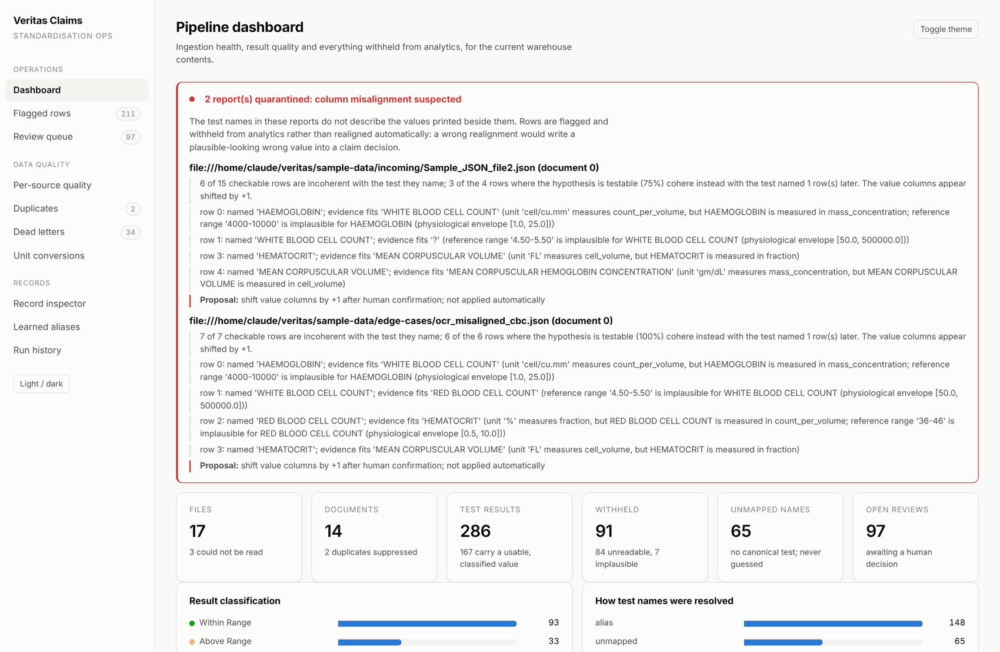
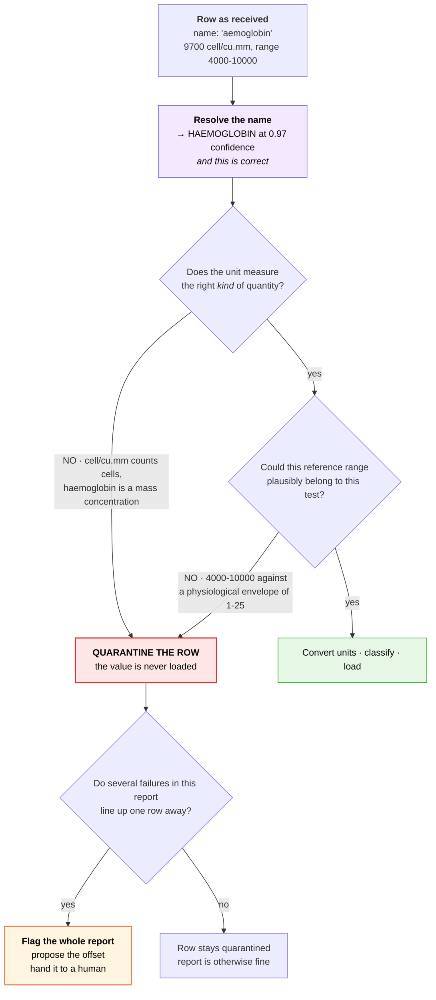
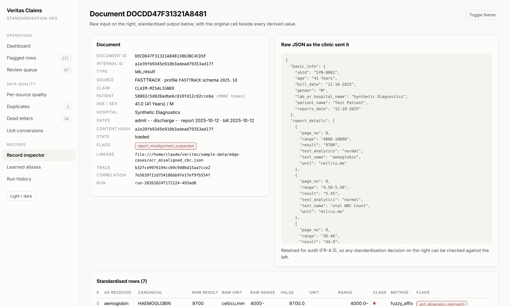
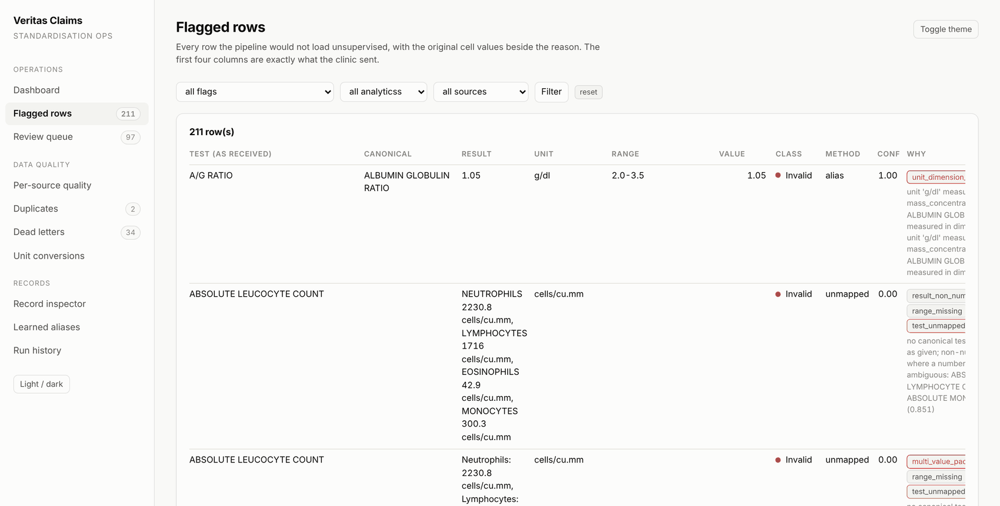
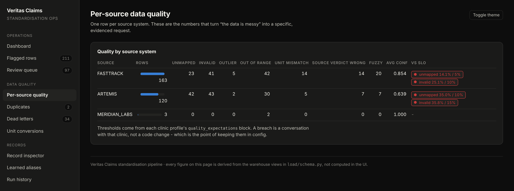
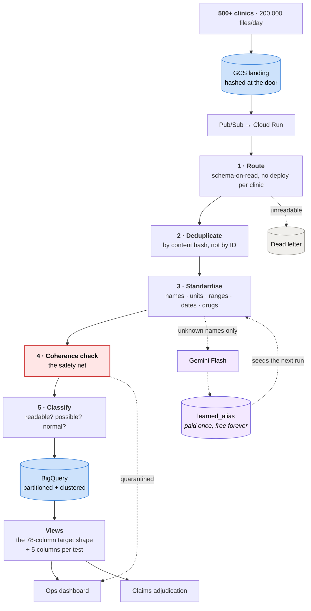
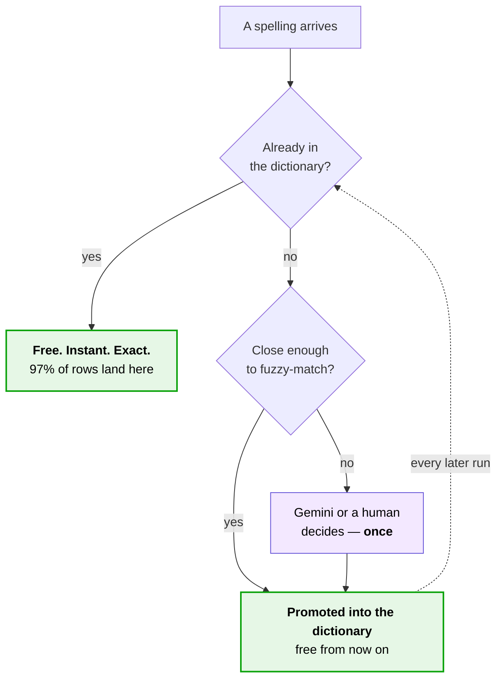
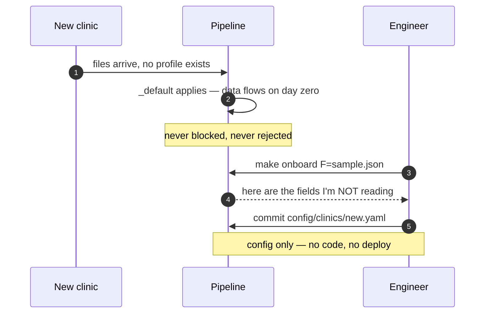

<div align="center">

# Veritas Claims — Medical Data Standardisation

**Raw clinic JSON in. A clean, auditable analytics schema out.**

Every standardisation decision is recorded, so a claims analyst can always ask *"why does this number say that?"* — and get an answer.

[](https://www.python.org/)
[](pyproject.toml)
[](tests/)
[](#every-requirement-verified)
[](pyproject.toml)

<sub>Take-home submission · Customer Engineer (Agents, AI & Data) · *GenAI in Data Engineering*</sub>

</div>

<br>



---

## The 60-second version

Veritas Claims receives 200,000 medical reports a day from 500+ clinics. Every clinic spells things differently, so the same blood test arrives under six different names and four different units. Claims can't be adjudicated automatically until that mess is standardised.

That's the brief. **Here's what I found when I opened the actual data:**

> [!CAUTION]
> **In one of the two sample lab reports, the test names don't belong to the values printed next to them.**
>
> A row labelled *haemoglobin* is carrying a **white blood cell count**. Load that into a claims system and it will approve or deny treatment based on a number that was never measured — and nothing downstream will ever flag it, because the row looks perfectly normal.

So this pipeline isn't really about matching strings. It's about **never letting a number reach a claim decision unless we can prove it means what it says.**

| | |
|---|---|
| **The naive approach** | Match `aemoglobin` → `HAEMOGLOBIN`, load the value, move on. Fast, and silently wrong. |
| **What I built** | Every test declares what its measurements must *look like*. A row that fails is quarantined, not loaded. A whole report that looks shifted is flagged for a human — **never auto-corrected**. |
| **Why not auto-correct?** | Because if the guess is wrong, we've written a *plausible* wrong value into a medical claim. That's worse than writing nothing. |

Everything else — the units, the duplicates, the dates, the brand-name drugs — is ordinary data engineering. **This one finding is why the architecture looks the way it does.**

---

## The finding, in detail

This is `Sample_JSON_file2.json`, exactly as the clinic sent it:

```jsonc
{ "test_name": "aemoglobin",    "range": "4000-10000", "unit": "cell/cu.mm", "result": "9700"  }
{ "test_name": "tal WBC Count", "range": "4.50-5.50",  "unit": "mil/cu.mm",  "result": "5.45"  }
{ "test_name": "BC INDICES",    "range": "36-46",      "unit": "%",          "result": "44.9"  }
{ "test_name": "ematocrit HCT", "range": "83-101",     "unit": "FL",         "result": "82"    }
```

Read row 0 on its own. Haemoglobin is a **mass concentration**, normally 13–17 **g/dL**.
This row carries 9700, in a range of 4000–10000, in **cell/cu.mm** — a unit that counts cells.

That is not a haemoglobin. **That's a white cell count.**

Now look at all four together:

| row | the name says… | …but the values are a | 
|:--:|---|---|
| 0 | Haemoglobin | **white cell count** ← belongs to row 1's name |
| 1 | Total WBC count | **red cell count** ← belongs to row 2's name |
| 2 | RBC indices | **haematocrit** ← belongs to row 3's name |
| 3 | Haematocrit | **MCV** ← belongs to row 4's name |

The names are a standard blood panel in printed order. The values are **the same panel, one step later**. An OCR row-drop shifted one column against the other — and separately cropped a character off the front of every name (`aemoglobin`, `tal WBC`, `ematocrit`).

> [!IMPORTANT]
> **The same pattern appears in a second file, from a different source system.** This is systemic, not one bad scan. If it holds across the feed, unverifiable values are entering a material share of claims every single day.

### Why a fuzzy matcher makes it worse

A fuzzy matcher resolves `aemoglobin` → `HAEMOGLOBIN` at **0.97 confidence**, and it is *completely correct about the name*. Then it loads a white cell count into a haemoglobin column.

**String matching can't catch this, because the string matching isn't wrong.** Something else has to.

### What the pipeline does instead

Every canonical test declares a **unit dimension** and a **plausible value envelope**. Two independent checks run on every row:



And here's what it actually reports, unprompted:

> **6 of 15 checkable rows are incoherent with the test they name; 3 of the 4 rows where the hypothesis is testable (75%) cohere instead with the test named 1 row later. The value columns appear shifted by +1.**
>
> *Proposal: shift value columns by +1 after human confirmation — **not applied automatically**.*

---

## Try it in 30 seconds

```bash
pip install pyyaml      # the only runtime dependency. there is no second one.
make demo               # processes all 17 sample files, prints what it found
make serve              # opens the operations dashboard
```

No cloud account. No API key. No build step. No `node_modules`. Python 3.10+ and one library.

<details>
<summary><b>What <code>make demo</code> prints</b> (click to expand)</summary>

```
  files      discovered=17  processed=14  skipped=0  failed=3
  documents  emitted=14  duplicate=2
  rows       emitted=286  flagged=211  invalid=84  outlier=7  out_of_range=74
  medicines  emitted=45
  review     dead_letters=34  queue=97  misaligned_reports=2
  genai      calls=3  cache_hits=0

  dead-lettered    16  panel_heading
  dead-lettered     4  section_heading
  dead-lettered     1  malformed_json          ← and the run kept going
  ...
  REPORT QUARANTINED FOR SUSPECTED COLUMN MISALIGNMENT
    row 0: named 'HAEMOGLOBIN'; evidence fits 'WHITE BLOOD CELL COUNT'
  ...
  SOURCE VERDICT WRONG on 21 of 99 checkable rows (21%) — recomputed
```

Three files fail **on purpose** — a truncated JSON, a top-level array, an empty document list. The run continues. One clinic's bad upload must never stop the other 499.

</details>

---

## What you get

<table>
<tr>
<td width="50%" valign="top">

**Record inspector** — the clinic's raw JSON on one side, the standardised output on the other, with the original cell beside every derived value and the reasoning spelled out.

</td>
<td width="50%" valign="top">

**Flagged queue** — every row the pipeline refused to load unsupervised, filterable by reason, source and classification.

</td>
</tr>
<tr>
<td></td>
<td></td>
</tr>
</table>

**Per-source quality**, with each clinic measured against the SLOs declared in its own config file — so a breach becomes a specific conversation with that clinic, not a vague "the data is messy".



---

## How it works



### Name resolution: five tiers, cheapest first

| tier | method | confidence | handles |
|:--:|---|:--:|---|
| 1 | exact / alias lookup | `1.00` | `Hb`, `HGB`, `CREATININE, SERUM` |
| 2 | normalised string | `0.97` | punctuation, case, word order |
| 3 | **affix-tolerant fuzzy** | `score` | `aemoglobin`, `atelet Count`, `eutrophils` ← the OCR crops |
| 4 | Gemini Flash *(tail only)* | `≤0.80` | spellings never seen before |
| 5 | human review queue | `—` | everything else — **never guessed** |

Tier 3 is hand-written rather than a library, because the dominant defect is a *crop*, and edit distance alone has no notion that losing an affix is far likelier than changing a middle character. Affix matches are reported as their own method — so **a clinic whose scanner is degrading becomes a number on a dashboard** instead of a mystery.

Every resolution also records *how* it was reached. An analyst can see a value came from a 0.88 fuzzy match with two near-ties, and exclude it.

### Three questions, deliberately kept apart

|  | question | answer | why separating them matters |
|:--:|---|---|---|
| 1 | Is it **readable**? | `Invalid` | a collapsed column isn't a measurement |
| 2 | Is it **possible**? | `Outlier` | haemoglobin 0.1 is a broken feed, not a dying patient |
| 3 | Is it **normal**? | `Within` / `Above` / `Below Range` | the actual clinical finding |

Collapse 2 into 3 and you send broken feeds to the clinical review queue — burying the genuine critical values among them.

---

## Ten findings in the sample data

Every one is reproducible with `make profile`, straight from the raw files, with no pipeline code involved.

| # | what I found | the evidence |
|:--:|---|---|
| **1** | **Test names shifted off their values** | above — and it recurs in a second source system |
| **2** | **The clinic's own verdict is wrong 41% of the time** | 24 of 59 checkable rows. `82` in range `83-101` labelled *"normal"* |
| **3** | **One column, two meanings** | `test_analytics` holds interpretations *and* assay methods **inside one file** |
| **4** | **Duplicates don't share IDs** | files 1 & 3 are the same discharge summary with different `documentId` **and** `claim_no` → `DISTINCT document_id` adjudicates that claim twice |
| **5** | **Panels repeat across pages** | 73 of 193 rows in file 4 are verbatim repeats |
| **6** | **Eleven different result grammars** | `4,290 cells/cu.mm` · `H 0.7 %` · `100/60 mmHg` · `99% On Room Air` · `OTE` |
| **7** | **Values hidden inside names** | `"LFT ( SGOT - 38, SGPT -14, ALP - 127)"` — three measurements no rule would ever read |
| **8** | **Placeholders treated as data** | the PDF's header row · `reports_date: "DD/MM/YYYY"` · a bill *number* in `bill_date` |
| **9** | **49 unit spellings** | including OCR damage: `gm/di`, `FI`, `UIL` — and the Indian `lakhs/cumm` (10⁵) |
| **10** | **Ambiguity only the unit can settle** | `NEUTROPHILS` in `%` and in `cells/cu.mm` are *different tests* with different ranges |

📄 **Full write-up with evidence → [`docs/data-profile.md`](docs/data-profile.md)**

---

## Where GenAI belongs

The tempting design hands every row to a model. It would work. It's still wrong:

```
LLM on every row    ████████████████████████████████████   ~$3,300 / day
LLM on the tail     ▏                                      ~$0.17  / day
```

30M rows/day vs ~2,000 genuinely novel names/day. The dictionary already answers 97% of rows **exactly, reproducibly, and for free** — swapping that for a probabilistic call adds no accuracy and removes reproducibility. And a claims decision that can't be reproduced can't be defended to a regulator.

So GenAI does only what deterministic code can't: **name a test from a spelling never seen before**, and **recover values buried inside names**. Every accepted answer is promoted into the alias dictionary:



That ratchet is the mechanism behind the brief's *"98% of variants resolved within 30 days"* — **not a hope, a decaying tail.**

> [!NOTE]
> With no API key the pipeline runs a deterministic local fallback, labelled `stub`, so output is identical on every run and nothing from the fallback can be mistaken for a model decision.

---

## The numbers

<table>
<tr><td width="33%" valign="top">

### ⚡ Throughput
**16.5 files/sec** per worker
**0.061 CPU-sec** per 150-row file

200k files/day = **2.31 files/sec**, so **one instance** covers the steady state *and* the 2× burst, with 7× headroom.

</td><td width="33%" valign="top">

### 💰 Cost
**~$50/month** all-in at 200k files/day.

Largest line is **GCS operations, not compute** — a useful corrective to the instinct to optimise the code.

</td><td width="33%" valign="top">

### 🔁 Idempotency
Run it twice, get the same warehouse. **Proven, not claimed** — `make verify` compares row counts *and* a content checksum.

</td></tr>
</table>

That 2.31 files/sec is the entire basis for choosing **Cloud Run over Dataflow** — which can't scale below one always-on worker plus a shuffle service, and would cost roughly 10× for a capability this problem doesn't need.

```
$ make verify
                              run 1        run 2
clinical_document               14           14
lab_result                     286          286
content checksum  70f5c81fd24ea9b8  70f5c81fd24ea9b8
rows written                   286          286     ← not 0. a rerun genuinely refreshes.

IDEMPOTENT: the second run rewrote the same rows with the same values.
```

---

## Deliberate trade-offs

| decision | the alternative | why |
|---|---|---|
| Cloud Run + Pub/Sub | Dataflow streaming | 2.3 files/sec needs **one worker**. Dataflow's floor is an always-on worker plus shuffle. ~10× cheaper here. |
| Micro-batch (minutes) | True streaming | The SLO is 15 minutes. Batching is free; per-record writes are billed. |
| Schema-on-read | Schema-on-write contracts | A new clinic must never need a deploy. Cost: a profile typo is a silent miss — mitigated by the onboarding coverage report. |
| Narrow fact table + views | The 78-column table as storage | Adding a test must not add columns. Cost: one join, paid once in SQL. |
| Declared physiological bounds | Statistical outlier detection | A per-batch rule makes the same value an outlier on a quiet day and normal on a busy one — and can't be explained to a clinician. |
| **Flag and quarantine** | **Auto-correct the misalignment** | **A wrong realignment is undetectable downstream. Refusing to be clever is correct when the cost of being wrong is a mis-adjudicated claim.** |
| GenAI on the tail | GenAI per row | Four orders of magnitude of cost, for no gain where a dictionary already answers. |
| SQLite in the prototype | DuckDB | DuckDB is the better engine; SQLite is in the standard library, so `make demo` runs with **nothing installed**. |

---

## Zero-code clinic onboarding

Adding a clinic is a config change. `sample-data/edge-cases/unprofiled_clinic.json` uses *entirely different* field spellings (`patientName`, `testName`, `reference_range`, `units`) under a source system with no profile at all — **it loads end to end**, and a test asserts it.

The real bottleneck isn't writing the YAML. It's knowing what you missed:

```console
$ make onboard F=sample-data/edge-cases/unprofiled_clinic.json

source_system  MERIDIAN_LABS
profile        _default (schema fallback)
coverage       71.9% (23/32 fields read)

fields the profile does NOT read:
  - data.responseDetails[].data.report_details[].flag
  - data.responseDetails[].fileId
Map each one in config/clinics/<clinic>.yaml, or record the decision to drop it.
```

That list **is** the onboarding checklist. Every field is either mapped or consciously dropped — not discovered six months later in a data-quality review.



---

## Every requirement, verified

Not claimed — **queried from the live demo database**. All 11 required *and* all 9 optional requirements are implemented.

<details>
<summary><b>FR-1 to FR-5 · full verification table</b> (click to expand)</summary>

| requirement | | evidence from the actual run |
|---|:--:|---|
| FR-1.1 Multi-source ingestion | ✅ req | 3 source systems, 17 files |
| FR-1.2 Duplicate detection (configurable) | ✅ req | 2 suppressed; strategy per clinic profile |
| FR-1.3 Schema flexibility | ✅ req | unprofiled clinic loaded via `_default` |
| FR-2.1 Test name normalisation | ✅ req | 6 resolution methods in use, all recorded |
| FR-2.2 Fixed 5 columns per test | ✅ req | `v_test_wide` = 326 cols (6 + 64 tests × 5) |
| FR-2.3 Numeric conversion | ✅ req | 214 values parsed from 11 grammars |
| FR-2.4 Unit harmonisation | ✅ req | 7 rows converted; value **and** range together |
| FR-2.5 Demographics | ✅ *opt* | ages incl. `33Y11M26D`, `6/12`; ISO dates |
| FR-2.6 Medicine mapping | ✅ *opt* | 18 distinct molecules from brand names |
| FR-3.1 Range validation | ✅ req | 171 rows range-checked |
| FR-3.2 Outlier detection (separate) | ✅ req | 7 outliers vs 74 out-of-range — **kept apart** |
| FR-3.3 Analytics classification | ✅ *opt* | all 5 values + `Not Applicable` |
| FR-3.4 Incorrect value flagging | ✅ *opt* | 29 flagged |
| FR-4.1 Structured DB load | ✅ req | SQLite + BigQuery from **one** schema definition |
| FR-4.2 Error log / dead letter | ✅ *opt* | 34 entries across 11 reason codes |
| FR-4.3 Audit trail (raw JSON) | ✅ *opt* | raw payload retained beside every document |
| FR-5.1 Pipeline dashboard | ✅ req | files · processed · failed · flagged |
| FR-5.2 Record inspector | ✅ *opt* | raw JSON beside standardised output |
| FR-5.3 Flagged records queue | ✅ *opt* | filterable, with reasons |
| FR-5.4 Clinic-level summary | ✅ *opt* | per-source quality vs configured SLOs |

</details>

<details>
<summary><b>Non-functional requirements · NFR-1 to NFR-5</b> (click to expand)</summary>

| | how it's addressed |
|---|---|
| **NFR-1** Scale & performance | Measured, not estimated: 16.5 files/s per worker. 200k/day = 2.31 files/s → one instance. Latency budget breaks down to **<3 min p95** against a 15-min SLO. |
| **NFR-2** Clinic onboarding | Four config files; profiles inherit from `_default`. The `onboard` command prints the field-coverage checklist. Schema versioning via `match:` + priority. |
| **NFR-3** Reliability | A failure is a *row*, not an exception — 7 distinct failure modes each with a reason code and a test fixture. Idempotency proven by `make verify`. |
| **NFR-4** Quality & governance | 12 lineage columns on every fact row; `trace_id`/`correlation_id` **adopted from the source** so a trace survives end to end. HMAC-SHA256 PII tokens. |
| **NFR-5** Observability | Structured JSON logs; log-based metrics; 4 Terraform alert policies. The one that matters most fires when **everything looks fine and the data is wrong**. |

📄 Full detail → [`docs/nfr-notes.md`](docs/nfr-notes.md)

</details>

---

## Three bugs worth confessing

All three were **silent** — the pipeline produced plausible output and nothing failed. Each now has a regression test in [`tests/test_regressions.py`](tests/test_regressions.py).

| # | the bug | how it was caught |
|:--:|---|---|
| 1 | Fuzzy shortlist ties were broken by **set iteration order**, so the same test name resolved to *different tests in different processes* | A test that forks subprocesses under varying `PYTHONHASHSEED`. An in-process test cannot catch it. |
| 2 | A document was treated as **its own duplicate** on reprocessing, so reruns emitted zero rows — a config fix would never have updated the warehouse | `make verify` showing `rows written: 286 → 0` |
| 3 | A lint auto-fix silently raised the **minimum Python to 3.11** | Running the suite on a machine with 3.10 |

Bug 1 is the one I'd want to be judged on. Both answers looked entirely reasonable, nothing errored — and it defeats the reproducibility the whole audit trail depends on.

---

## Repository map

```
📁 config/            everything clinic- and domain-specific — no code changes needed
   test_catalog.yaml    64 canonical tests: aliases, units, ranges, envelopes, LOINC
   units.yaml           16 dimensions, 119 unit spellings (incl. OCR variants)
   clinics/*.yaml       per-source profiles, inheriting from _default
   medicines.yaml       brand → molecule
   pipeline.yaml        every threshold that changes an outcome

📁 src/veritas/
   ingest/             file discovery · envelope routing · deduplication
   standardise/        names · numeric · units · ranges · dates · drugs · PII · GenAI tail
   validate/           rules.py (classification) · coherence.py ← the safety net
   load/               schema.py (one definition → both dialects) · sinks
   ui/                 the operations dashboard

📁 sample-data/
   incoming/           the 5 supplied files, unmodified
   edge-cases/         12 generated files — one per requirement path

📁 docs/               architecture · data-profile · assumptions · nfr-notes · cost-model
📁 infra/              Terraform: GCS · Pub/Sub · Cloud Run · BigQuery · 4 alert policies
📁 tests/              183 tests, stdlib unittest, zero install required
```

| command | what it does |
|---|---|
| `make demo` | process all sample data, summarise what was found |
| `make serve` | operations dashboard |
| `make test` | 183 tests |
| `make verify` | run twice, **prove** idempotency |
| `make profile` | reproduce the ten findings from the raw files |
| `make bench` | throughput, capacity and cost projection |
| `make cost` | the GenAI cost comparison |
| `make onboard F=…` | field-coverage report for a new clinic |

---

## Known limitations

Stated plainly. Full set with mitigations → [`docs/assumptions.md`](docs/assumptions.md).

- **A blank unit is assumed to mean canonical units.** 96 rows take this path. Mitigated by the envelope check, which usually catches a wrong-scale value as an Outlier. Production needs per-clinic default units.
- **Reference ranges are adult values.** The corpus includes a 16 kg child, so some out-of-range flags on that record are false positives. The model already carries age and sex; the bands are the missing part.
- **LOINC codes are indicative** — hand-assigned, not validated against an official release. Don't treat them as authoritative yet.
- **The medicine reference is 21 brands.** Uncertain mappings carry `verify: true` and their rows are flagged. Production needs a licensed drug master.
- **The review queue is read-only.** It shows decisions and the config they'd write; accepting one isn't implemented.

---

## The one thing I'd want to discuss

Finding #1 rests on reading the sample data as an **OCR row-drop**. The evidence is strong — the names form a standard panel in printed order, the values form the same panel one step later, the names are cropped at the left edge, and the pattern recurs across two source systems.

But it is an inference about *someone else's* document pipeline, and I'd want a domain expert to confirm it before anyone acts on the proposed offset.

> [!TIP]
> **That uncertainty is precisely why the pipeline flags and proposes rather than correcting.**
>
> If the reading is right, an analyst accepts the offset in one click.
> If it's wrong, nothing has been corrupted — the rows were withheld, not rewritten.

<div align="center">
<br>
<sub>Built for the Veritas Claims take-home · <a href="docs/architecture.md">Architecture</a> · <a href="docs/data-profile.md">Data profile</a> · <a href="docs/assumptions.md">Assumptions</a> · <a href="docs/cost-model.md">Cost model</a></sub>
</div>
